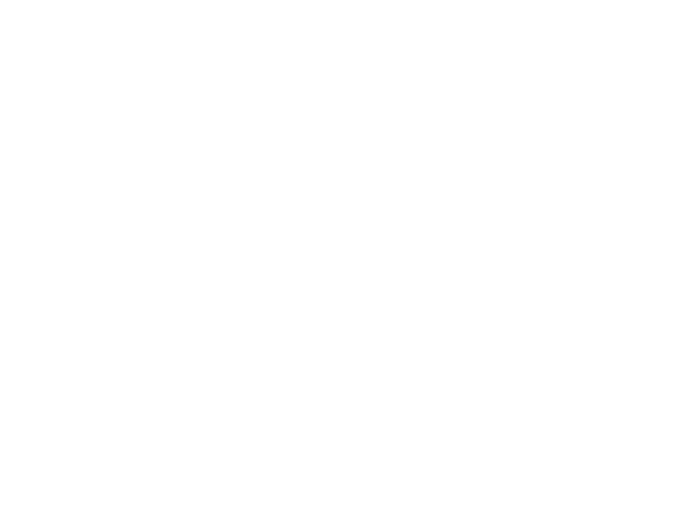
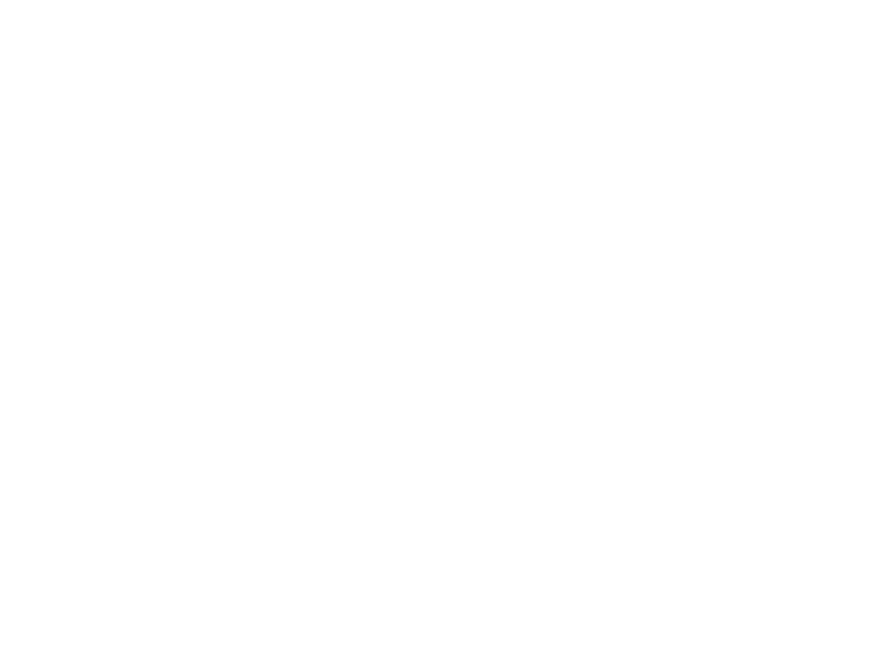
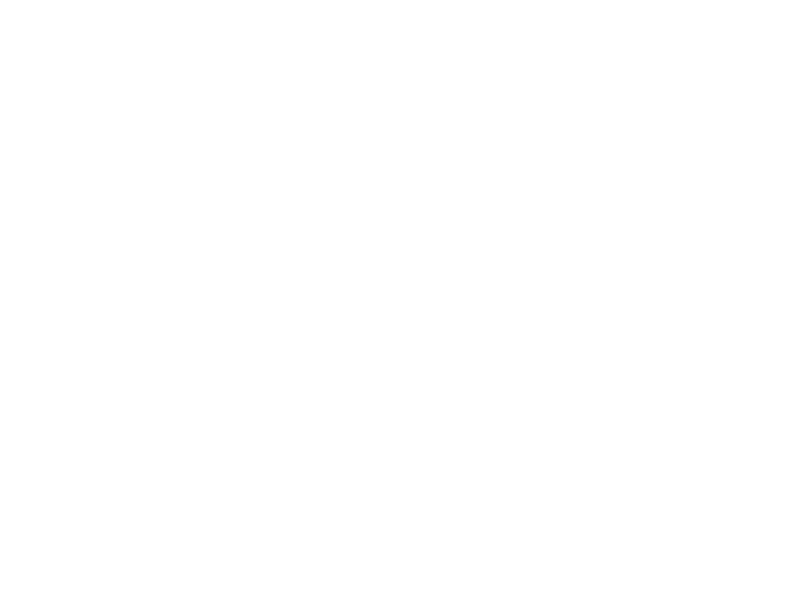

# Bike Sharing Data Analysis Project

This repository contains a data analytics project from the [Belajar Analisis Data dengan Python](https://www.dicoding.com) class by Dicoding. It analyzes the Bike Sharing Dataset (2011–2012) and presents the results in an interactive Streamlit dashboard.

## Project Structure

```
├── assets/
├── data/
│   ├── day.csv
│   └── hour.csv
├── analysis.ipynb
├── projectakhir.py
└── requirements.txt
```

## Features

- Data wrangling and exploratory data analysis (EDA) with pandas
- Visualization with Matplotlib and Seaborn
- Interactive dashboard with Streamlit
- Responsive charts that adapt to the screen size

## Business Questions

1. At what hour are bike rentals at their highest (working vs non-working days)?
2. Which season has the highest average daily bike rentals?
3. By what percentage did total bike rentals grow in 2012 compared to 2011, and in which month and user segment (casual/registered) was the growth highest?

## Installation

1. Clone the repository

```bash
git clone https://github.com/felixb177/analisisdata.git
cd analisisdata
```

2. Create a virtual environment

Using Conda:

```bash
conda create --name bike-sharing python=3.11
conda activate bike-sharing
pip install -r requirements.txt
```

3. Run the Streamlit app

```bash
streamlit run projectakhir.py
```

4. (Optional) Open the notebook

```bash
pip install jupyter
jupyter notebook
```

## 🧪 Result
### Peak Hours
<p align="left">
	
</p>

### Seasonal Rentals
<p align="left">
	
</p>

### 2011 vs 2012 Growth
<p align="left">
	
</p>

## ✨ Acknowledgements

- [Dicoding](https://www.dicoding.com)
- [Bike Sharing Dataset](https://archive.ics.uci.edu/dataset/275/bike+sharing+dataset)
- [Streamlit Docs](https://docs.streamlit.io/)
- [Pandas Docs](https://pandas.pydata.org/docs/)
